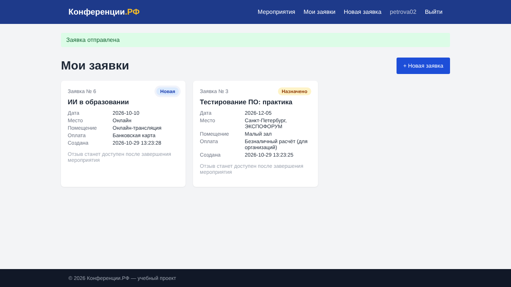

# Задание № 1 (Тема 3.1). Чек-лист, тест-кейсы, баг-репорт

Объект — веб-сервис «Конференции.РФ». Чек-лист из 35 проверок (30 Passed / 5 Failed), 5 тест-кейсов, баг-репорты BUG-01…BUG-03.

## Состав
- `Чек-лист.xlsx`
- `Тест-кейсы.xlsx`
- `Баг-репорт.docx`
- `screenshots/` — шаги воспроизведения дефектов
- `Отчёт_Задание_1.docx`

## Скриншот

