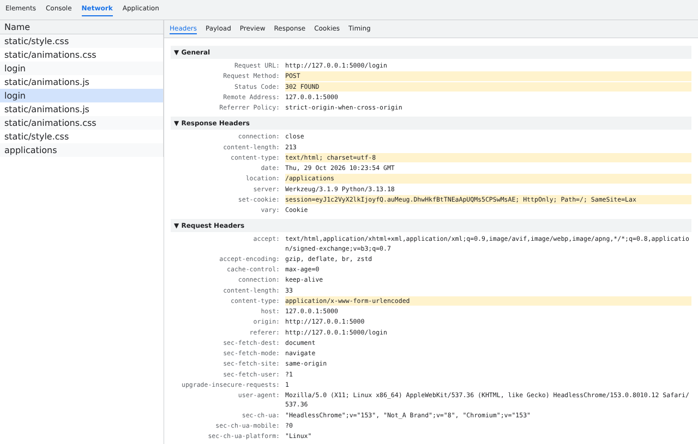

# Задание № 2 (Тема 3.2). Анализ HTTP-запроса и ответа через DevTools

Разобраны GET и POST-запросы: метод, статус-коды (200, 302, 304, 403, 404), заголовки, тела запросов и ответов, cookie сессии, кэширование.

## Состав
- `session.har` — сеанс из вкладки Network (открывается в DevTools: перетащить файл во вкладку Network)
- `screenshots/` — вкладка Network и детали запросов
- `Отчёт_Задание_2.docx`

## Скриншот

