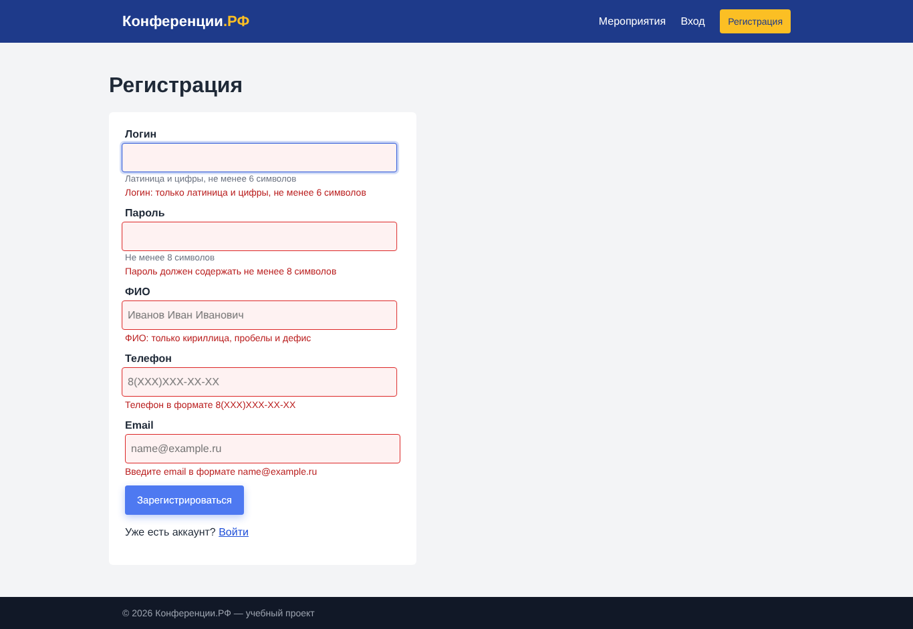

# Задание № 3 (Тема 3.3). Тестирование формы регистрации и авторизации

36 проверок (позитивные, негативные, граничные значения, безопасность): 30 пройдено, 6 дефектов.

## Состав
- `Результаты_тестирования_форм.xlsx`
- `autotest/test_forms.py` — автотест на Playwright
- `screenshots/`
- `Отчёт_Задание_3.docx`

## Скриншот

