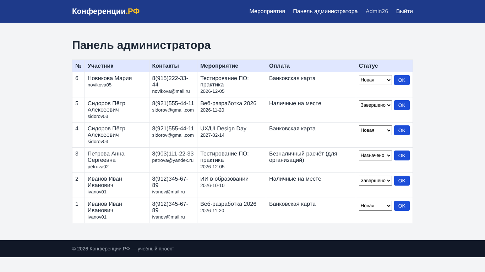

# Практическая работа № 3. Разработка модулей ИС в соответствии с ТЗ

Модули регистрации (валидация логина, пароля, телефона, email), авторизации, создания и просмотра заявок, панель администратора. ООП, разделение фронтенд/бекенд.

## Состав
- `app/` — исходный код
- `screenshots/` — скриншоты работы
- `Отчёт_ПР_03.docx` — отчёт

## Запуск
```bash
cd app
python3 -m venv venv && source venv/bin/activate   # Windows: venv\Scripts\activate
pip install -r requirements.txt
python app.py        # http://127.0.0.1:5000
```
Администратор: **Admin26 / Demo2026**.

## Скриншот

