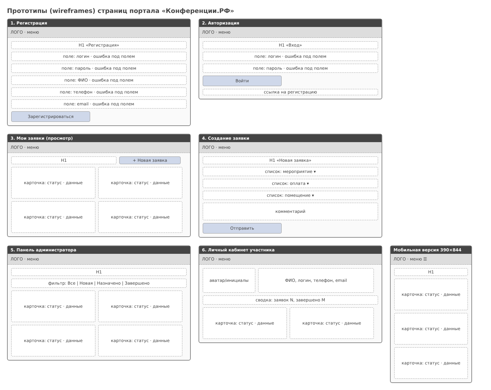

# Практическая работа № 6. Формирование требований к дизайну

Анализ предметной области и целевой аудитории, корпоративный стиль, проверка контраста по WCAG, список страниц и требования к каждой, прототипы.

## Состав
- `Требования_к_дизайну.docx` — документ требований (результат работы и отчёт)
- `materials/` — палитра, типографика, прототипы страниц

## Скриншот

