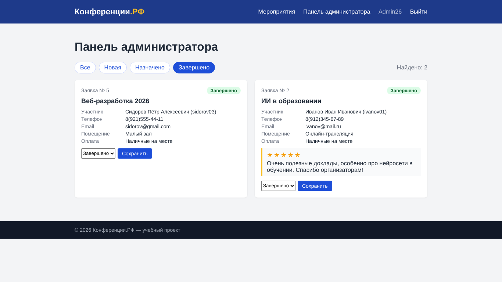

# Практическая работа № 9. Улучшение форм и интерфейса

Ошибки выводятся под полями (клиент + сервер), выпадающие списки «Способ оплаты» и «Помещение», карточки и фильтр по статусу в панели администратора, отзыв только после завершения мероприятия.

## Состав
- `app/` — исходный код
- `screenshots/` — скриншоты
- `Отчёт_ПР_09.docx` — отчёт

## Запуск
```bash
cd app
python3 -m venv venv && source venv/bin/activate   # Windows: venv\Scripts\activate
pip install -r requirements.txt
python app.py        # http://127.0.0.1:5000
```
Администратор: **Admin26 / Demo2026**.

## Скриншот

