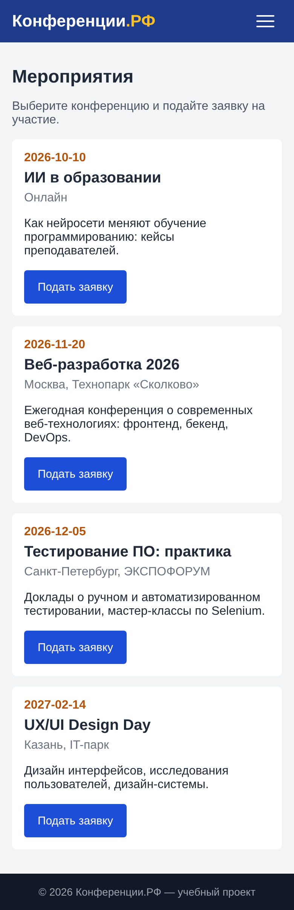

# Практическая работа № 13. Интеграция адаптивного дизайна

Резиновая сетка, медиа-запросы, меню-«бургер». Все страницы проверены на смартфоне 390×844 px — горизонтальной прокрутки нет.

## Состав
- `app/` — исходный код
- `screenshots/` — скриншоты «до» и «после» на 390×844, 768 и 1366 px
- `Отчёт_ПР_13.docx` — отчёт

## Запуск
```bash
cd app
python3 -m venv venv && source venv/bin/activate   # Windows: venv\Scripts\activate
pip install -r requirements.txt
python app.py        # http://127.0.0.1:5000
```
Администратор: **Admin26 / Demo2026**.

## Скриншот

