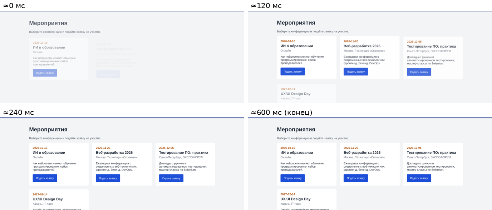

# Практическая работа № 14. Добавление анимации и микро-анимаций

Переходы между страницами и 10 микро-анимаций (карточки, кнопки, поля, уведомления, меню). Учитывается prefers-reduced-motion, производительность ~60 FPS.

## Состав
- `app/` — исходный код (`static/animations.css`, `static/animations.js`); `app/seed_demo.py` — демо-данные
- `screenshots/` — кадры анимаций
- `Отчёт_ПР_14.docx` — отчёт

## Запуск
```bash
cd app
python3 -m venv venv && source venv/bin/activate   # Windows: venv\Scripts\activate
pip install -r requirements.txt
python app.py        # http://127.0.0.1:5000
```
Администратор: **Admin26 / Demo2026**.

## Скриншот

